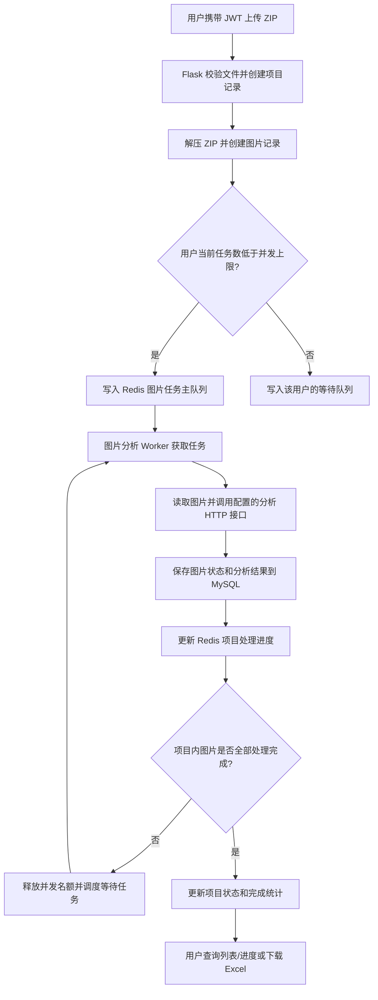

# ZIP 图片分析服务

这是一个面向病理切片图像处理场景的后端项目，围绕切片文件的批量接收、分析任务管理和结果追踪构建。服务使用 Flask 提供 API，使用 MySQL 保存用户、项目和图片记录，并通过 Redis 队列与独立 worker 处理图片任务。

## 项目背景

病理切片图像文件数量多、体积大，分析过程也可能耗时。如果用户只能逐张提交并等待同步结果，批量处理会占用请求连接，也很难查看哪些图像已完成、哪些失败。这个项目希望把流程拆成可追踪的步骤：用户一次上传一批图像，服务登记项目和文件，后台 worker 逐项调用分析接口，用户再查询整体进度并导出结果。

项目当前主要解决的是**上传和分析任务管理**问题，包括批量上传、异步排队、并发控制、状态记录、进度查询和结果汇总。图片分析通过 GLM 多模态接口完成，模型返回的图片描述保存在图片分析结果中；这属于图像内容描述，不等同于医疗诊断结论。

## 任务流程



其中 APScheduler 只负责按计划清理过期数据；图片分析任务由 Redis 队列和 worker 处理。

## 项目结构

| 路径 | 职责 |
| --- | --- |
| `app.py` | 创建 Flask 应用，初始化数据库、Redis、邮件和 JWT 扩展，注册各业务蓝图并启动定时清理任务。 |
| `config.py` | 数据库、Redis、邮件、上传目录、分析服务地址和任务并发/超时配置。 |
| `exts.py` | Flask 扩展实例及 UTC、本地时间转换工具。 |
| `models.py` | 用户、管理员、项目、图片分析结果等 SQLAlchemy 数据模型，以及软删除和过期清理逻辑。 |
| `forms.py` | 用户输入表单及其校验规则。 |
| `jwt_utils.py` | JWT 认证装饰器和用户身份校验。 |
| `scheduler.py` | APScheduler 定时清理过期用户和项目。它不负责图片任务调度。 |
| `blueprints/auth.py` | 用户注册、登录、邮箱验证码和密码重置。 |
| `blueprints/user_home.py` | 用户资料、账户操作、密码和用户名修改；当前根路由是带 5 秒延时的测试接口。 |
| `blueprints/file_processing/photo_transfer.py` | ZIP 上传、解压、图片记录创建及 Redis 分析队列入队。 |
| `blueprints/file_processing/fileprocessor.py` | 初始化项目进度、更新处理结果并汇总项目状态。 |
| `blueprints/file_processing/files_preview.py` | 用户文件列表、单文件查询和进度流接口。 |
| `blueprints/file_processing/project_select.py` | 管理端项目查询、上传统计、删除和恢复。 |
| `blueprints/file_processing/result_download.py` | 项目分析结果导出为 Excel。 |
| `blueprints/admin/` | 管理员认证、用户管理和异常项目相关接口。 |
| `workers/worker.py` | 从 Redis 获取图片任务，调用分析服务并更新图片及项目处理状态。 |
| `workers/run_image_worker.py` | 独立启动图片分析 worker 的入口。 |
| `migrations/` | Flask-Migrate/Alembic 数据库迁移环境和迁移脚本。 |
| `photo/` | ZIP 解压后的上传文件存储目录，属于运行数据。 |
| `logs/`、`workers/logs/` | Flask 服务和 worker 的运行日志。 |
| `requirements.txt` | Python 运行依赖。 |

## 运行依赖

- Python 3.11（项目当前使用 Python 3.11）
- MySQL，默认数据库名为 `testdb`
- Redis，默认连接本机 `localhost:6379`
- 可访问的图片分析 HTTP 服务

安装依赖：

```powershell
python -m venv .venv
.\.venv\Scripts\Activate.ps1
python -m pip install -r requirements.txt
```

## 配置

`config.py` 从系统环境变量和项目根目录的 `.env` 加载数据库、Redis、邮件、签名密钥及 GLM 分析接口配置，系统环境变量优先。首次部署时复制不含真实凭据的配置模板：

```powershell
Copy-Item .env.example .env
```

在本地 `.env` 中填写数据库密码、邮件授权码、GLM API 密钥及管理员邮箱白名单。分别运行以下命令生成随机值，填写 `SECRET_KEY`、`JWT_SECRET_KEY` 和 `SECURITY_KEY`：

```powershell
python -c "import secrets; print(secrets.token_hex(32))"
```

`SECRET_KEY` 和 `SECURITY_KEY` 为必填项，缺失时启动会提示变量名；`JWT_SECRET_KEY` 留空时使用 `SECRET_KEY`。`ADMIN_WHITELIST` 使用逗号分隔邮箱，留空时禁止管理员注册。也可以用 `DATABASE_URL` 和 `REDIS_URL` 分别覆盖数据库与 Redis 连接地址。Web、worker 和数据库迁移都会自动读取项目根目录的 `.env`。

也可以在 PowerShell 中设置环境变量，例如：

```powershell
$env:GLM_API_KEY = "你的 GLM API 密钥"
$env:ANALYSIS_API_URL = "https://open.bigmodel.cn/api/paas/v4/chat/completions"
$env:ANALYSIS_MODEL = "GLM-5.3-flash"
$env:MAX_ANALYSIS_TIME = "60"
```

不要把真实密钥写入 `config.py`、`.env.example` 或 Git。`.env` 及其他 `.env.*` 本地文件已被 Git 忽略，只有不含真实凭据的模板 `.env.example` 会上传。如果服务商给出的模型标识或接口地址不同，请以控制台文档为准调整 `ANALYSIS_MODEL` 和 `ANALYSIS_API_URL`。

分析超时可通过环境变量设置，默认 10 秒：

```powershell
$env:MAX_ANALYSIS_TIME = "30"
```

如果凭据曾出现在 Git 提交中，删除当前文件里的值后仍需更换相关密码或密钥，因为旧提交仍可能保留原值。

## 数据库迁移

在项目根目录执行：

```powershell
$env:FLASK_APP = "app.py"
flask db upgrade
```

## 启动

在两个终端中分别启动 Web 服务和图片 worker。两者都需要连接同一 MySQL 数据库和 Redis。

```powershell
# 终端一：Flask API
.\.venv\Scripts\Activate.ps1
python app.py
```

```powershell
# 终端二：图片任务 worker
.\.venv\Scripts\Activate.ps1
python -m workers.run_image_worker
```

开发服务器默认监听 `http://127.0.0.1:5000`。可通过 `GET /photo_transfer/health` 检查 ZIP 服务路由是否可用。

## 主要 API 路由

| 路由前缀 | 用途 |
| --- | --- |
| `/auth` | 注册、登录、验证码和密码重置。 |
| `/user_home` | 用户资料及账户操作。 |
| `/photo_transfer` | ZIP 上传和健康检查。 |
| `/files_preview` | 用户文件列表、单文件查询和处理进度。 |
| `/result_download` | 项目结果下载。 |
| `/admin_auth` | 管理员注册和登录。 |
| `/admin_user` | 管理员用户管理。 |
| `/admin_project` | 管理端项目列表、统计、删除和恢复。 |
| `/admin_error` | 管理端异常项目查询。 |

除健康检查及特定公开认证接口外，业务路由通常需要在 `Authorization` 请求头中提供 `Bearer <JWT>`。

## Git 忽略规则

`.gitignore` 会排除虚拟环境、Python 缓存、IDE 本地配置、运行日志、上传文件和本地环境变量文件。初始化仓库后，变更仍需由开发者自行检查并暂存、提交。
